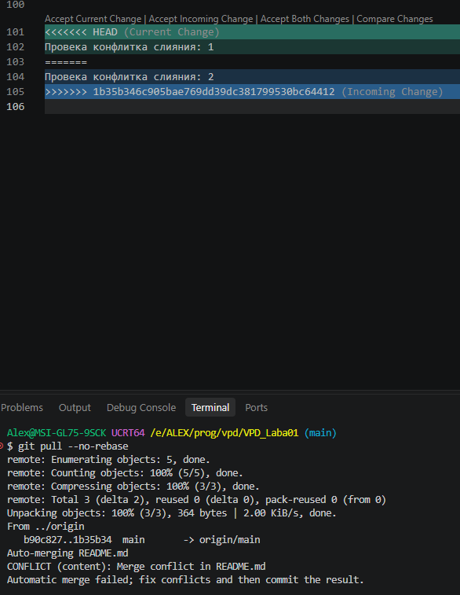
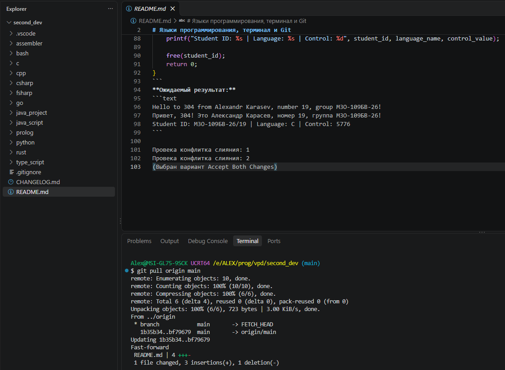

# Лабораторная работа № 1 
# Языки программирования, терминал и Git

Карасев Александр Сергеевич М3О-109БВ-26 19 
ОС и окружение: Windows 10 + VSCode + Git Bash

Цель проекта:
Получить первое практическое представление о различиях между языками программирования и 
их инструментальными экосистемами, научиться запускать программы из терминала и 
организовывать разработку небольшого проекта средствами Git.

Используемые языки:
1. C
2. C++
3. C#
4. F#
5. Go
6. Java
7. JavaScript
8. Python
9. Rust
10. TypeScript
11. Bash
12. Prolog
13. Assembler

|Язык|Версия инструмента|Команда сборки/запуска|Тип результата|
|:---:|:---:|:---:|:---:|
|C|gcc.exe (Rev5, Built by MSYS2 project) 16.1.0|gcc c/main.c -o c/main.exe && ./c/main.exe|Native Executable|
|C++|g++.exe (Rev5, Built by MSYS2 project) 16.1.0|g++ cpp/main.cpp -o cpp/main.exe && ./cpp/main.exe|Native Executable|
|C#|10.0.402|dotnet run csharp/main.cs|Bytecode|
|F#|10.0.402|dotnet fsi --exec fsharp/main.fsx|Bytecode|
|Go|go1.27.3 windows/amd64|go run go/main.go|Native Executable|
|Java|jdk-21.0.12.1|javac java_project/Main.java && java java_project/Main|Bytecode|
|JavaScript|node v24.22.1|node ./java_script/main.js|Script|
|TypeScript|node v24.22.1|tsc type_script/main.ts --outDir type_script/compiled  &&  node ./type_script/compiled/main.js|Script|
|Python|Python 3.14.5|python3 python/main.py|Script / Bytecode|
|Rust|rustc 1.99.1 (58cf8f9c3 2026-10-13)|rustc rust/main.rs -o rust/main && ./rust/main|Native Executable|
|Bash|GNU bash, version 5.3.15(2)-release (x86_64-pc-cygwin)|chmod +x bash/main.sh && ./bash/main.sh|Script|
|Prolog|SWI-Prolog version 10.0.2 for x64-win64|swipl -q -s prolog/main.pl -g main -t halt|Script / Bytecode|
|Assembler|GNU assembler (GNU Binutils) 2.46|as assembler/main.s -o assembler/main.o && gcc assembler/main.o -o assembler/main.exe && ./assembler/main.exe|Native Executable / Object File|

Дополнительная информация для Assembler:
- ОС: Windows 10 Pro, 64-разрядная
- Архитектура процессора: x86-64
- toolchain: VScode, as (GNU assembler 2.46), gcc (16.1.0)
- Команды сборки: as assembler/main.s -o assembler/main.o && gcc assembler/main.o -o assembler/main.exe 
- Команда запуска: ./assembler/main.exe

# Выводы строк:


Обеспечение корректного вывода кириллицы
Файлы main.cpp и main.c сохранены в кодировке UTF-8, компиляторы сохраняют символы кириллицы в .exe файлы по стандарту UTF-8,
но вывод в консоль происходит посредством встроенных потоков ввода/вывода windows, которые по умолчанию
принимают символы в кодировке cp866 что приводит к неверной интерпретации символов.
Для корректного вывод кириллицы в консоли в C/C++ использовалась команда настройки консоли
`SetConsoleOutputCP(65001)` - установка кодировки вывода символов в консоль на UTF-8
После её выполнения консоль корректно принимает байты символов в кодировке UTF-8

Блок кода функции main в файле main.c:
```c
int main(){

    // Настройка консоли на вывод кириллицы
    SetConsoleOutputCP(65001);

    // Входные данные
    const char *student_name_ru = "Александр Карасев";
    const char *student_name_en = "Alexandr Karasev";
    int student_number = 19;
    char group_number[] = "М3О-109БВ-26";
    const char *language_name = "C";
 
    int len_number = 0, i = 1, control_value;

    // Формирование строки student_id 
    while(student_number / i > 0){
        i *= 10;
        len_number++;
    }

    char *student_id = (char *)malloc(sizeof(group_number) + len_number + 2);
    snprintf(student_id, sizeof(group_number) + len_number + 2, "%s/%02d", group_number, student_number);
    
    // Вычисление контрольного значения
    control_value = 304 * student_number;

    // Вывод строк
    printf("Hello to 304 from %s, number %d, group %s!\n", student_name_en, student_number, group_number);
    printf("Привет, 304! Это %s, номер %d, группа %s!\n", student_name_ru, student_number, group_number);
    printf("Student ID: %s | Language: %s | Control: %d", student_id, language_name, control_value);

    free(student_id);
    return 0;
}
```
**Ожидаемый результат:**
```text
Hello to 304 from Alexandr Karasev, number 19, group М3О-109БВ-26!
Привет, 304! Это Александр Карасев, номер 19, группа М3О-109БВ-26!
Student ID: М3О-109БВ-26/19 | Language: C | Control: 5776
```

Провека конфлитка слияния: 1
Провека конфлитка слияния: 2
(Выбран вариант Accept Both Changes)

# Конфликт слияния
До разрешения:

После разрешения:


# Финальные выводы:
`git status`:

`git log --oneline --graph --all --decorate`:

`git tag`:

`git remote -v`: